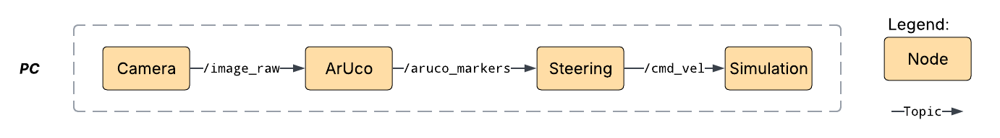

# demo_ar_steering
This demo lets you steer Robotont using ArUco markers. The marker detection is done on your PC, while the commands are sent to either a simulated or a real robot.

## Prerequisites
By default, all neccessary packages are installed by `rosdep install`. If that fails, install them manually:
```bash
sudo apt install ros-jazzy-usb-cam ros-jazzy-image-pipeline ros-jazzy-tf-transformations
```

The first step after installation, is to **calibrate** your camera.
1) Start the camera node:
```bash
ros2 run usb_cam usb_cam_node_exe
```

2) List the topics and services. Note the names of the `/image_raw` and `/set_camera_info` namespaces:
```bash
ros2 topic list
ros2 service list
```

3) Run the calibration node. The calibration target is in the `assets` folder. If you use your own target, make sure the `--size` and `--square` parameters match. This calibrates the camera and saves the configuration to `~/.ros/camera_info/default_cam.yaml`:
```bash
ros2 run camera_calibration cameracalibrator --size 8x6 --square 0.108 --ros-args -r image:=<image_raw_topic> -r camera/set_camera_info:=<set_camera_info_topic>
```

4) Move the calibration target until you can press buttons *calibrate*, *save* and *commit*. Note, that saving can freeze your computer for a few minutes.

5) Verify that the calibration file `~/.ros/camera_info/default_cam.yaml` has been created.


## Launching the demo
The demo has two configurations. You can either run a simulation locally in `rviz`, the ROS 2 visualization tool, or run it on a physical robot. Two launch files handle all the necessary nodes and configuration. First, build the project and source the workspace:
```bash
colcon build
source install/setup.bash
```

Both launch files declare the following parameters, which you can override from the command line:

| Parameter | Default | Description |
|---|---|---|
| `marker_id` | `0` | ID of the AR marker to detect |
| `cmd_vel_topic` | `/cmd_vel` | Topic the velocity commands are published to |

Run a local simulation:
```bash
ros2 launch demo_ar_steering sim.launch.py marker_id:=<id> cmd_vel_topic:=<topic>
```

To run the demo on a physical robot, the robot and the PC must be on the same network:
```bash
ros2 launch demo_ar_steering irl.launch.py marker_id:=<id> cmd_vel_topic:=<topic>
```

## Architecture
The simplified diagrams below show how the nodes and topics connect in each configuration.

The simulation runs locally on one machine, so every node communicates on the same computer:  


On the physical setup, the camera and the steering logic run on the PC and the velocity commands travel over the network to the robot:  

