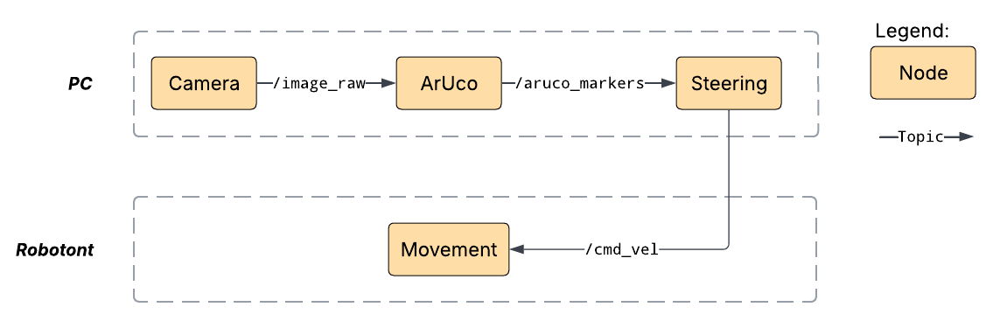

# demo_ar_steering
This demo lets you steer Robotont using **ArUco** markers. The marker detection is done on your **PC**, while the commands are sent to either a **simulated** or a **real robot**.

## Prerequisites
### Installing dependencies on PC
If this is your **first** time using `rosdep` on this machine, initialize and update it first:
```bash
# register rosdep's package index with the system
sudo rosdep init

# download the latest rosdep package index
rosdep update
```

Then, let `rosdep` install necessary packages:
```bash
# move to demo repository
cd ~/jazzy_demos

# install dependancies
rosdep install -from-paths src --ignore-src -r -y
```

You now should be able to run the `usb_cam` node:
```bash
# run the camera node
ros2 run usb_cam usb_cam_node_exe
```

In case installation fails, check the dropdown below.

<details>
<summary>Help, the install failed</summary>

If `rosdep install` fails, install packages manually:
```bash
# install packages otherwise installed by rosdep
sudo apt install ros-jazzy-usb-cam ros-jazzy-image-pipeline ros-jazzy-tf-transformations
```

</details>

### Camera calibration on PC
The first step after installation, is to **calibrate** your camera.
1) Start the camera node:
```bash
# run the camera node
ros2 run usb_cam usb_cam_node_exe
```

2) In a separate terminal, list the topics and services. Note the names of the `/image_raw` and `/set_camera_info` namespaces:
```bash
# list available topics
ros2 topic list

# list available services
ros2 service list
```

3) Run the calibration node. The calibration target is in the `assets` folder. If you use your own target, make sure the `--size` and `--square` parameters match. This calibrates the camera and saves the configuration to `~/.ros/camera_info/default_cam.yaml`:
```bash
# run the camera parameter calibration node
ros2 run camera_calibration cameracalibrator --size 8x6 --square 0.108 --ros-args -r image:=<image_raw_topic> -r camera/set_camera_info:=<set_camera_info_service>
```

4) Move the calibration target until you can press buttons *calibrate*, *save* and *commit*. Note, that saving can freeze your computer for a few minutes.

5) Verify that the calibration file `~/.ros/camera_info/default_cam.yaml` has been created.


## Launching the demo
First, build the project and source the workspace on your **PC**:
```bash
# move to demo repository
cd ~/jazzy_demos

# source ROS2
source /opt/ros/jazzy/setup.bash

# build the workspace 
colcon build

# source built packages
source install/setup.bash
```

The demo consists of two launch files:

* `sim.launch.py` runs a simulation locally in `rviz`, the ROS 2 visualization tool.
* `irl.launch.py` runs the demo it on a physical robot by sending commands on a particular topic.

Both launch files declare the following parameters, which you can override from the command line:

| Parameter | Default | Description |
|---|---|---|
| `marker_id` | `0` | ID of the AR marker to detect |
| `cmd_vel_topic` | `/cmd_vel` | Topic the velocity commands are published to |

Run the local simulation on **PC**:
```bash
# launch the simulation on PC
ros2 launch demo_ar_steering sim.launch.py marker_id:=<id> cmd_vel_topic:=<topic>
```

To send commands to a  physical robot both devices must be on the same network. Run the demo on **PC**:
```bash
# launch irl demo on PC
ros2 launch demo_ar_steering irl.launch.py marker_id:=<id> cmd_vel_topic:=<topic>
```

## Architecture
The simplified diagrams below show how the nodes and topics connect in each configuration.

The simulation runs locally on one machine, so every node communicates on the same computer:  


On the physical setup, the camera and the steering logic run on the PC and the velocity commands travel over the network to the robot:  

